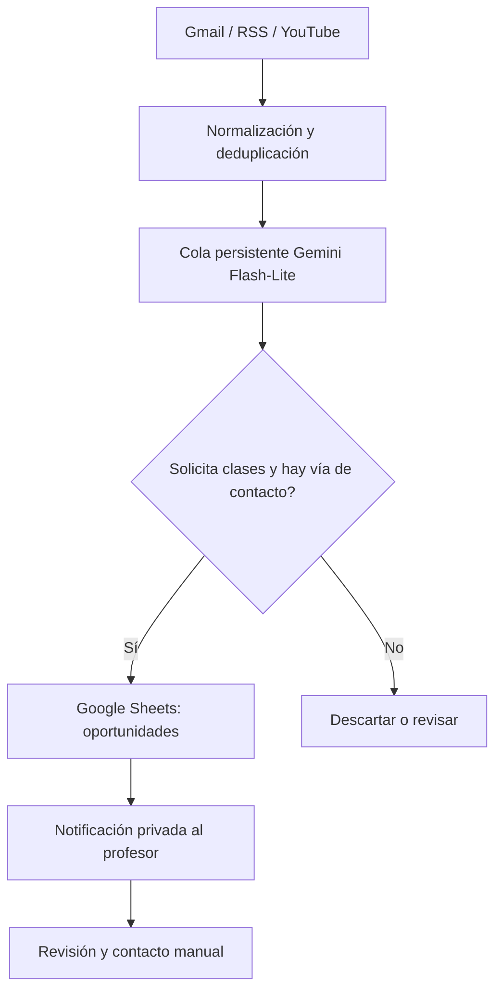

# Student Lead Discovery Agent

**Prototipo en auditoría; no desplegado.** Sistema de descubrimiento de solicitudes de clases particulares con supervisión humana, desarrollado con Google Apps Script, Gmail, Sheets, YouTube Data API y Gemini.

## Arquitectura



## Implementado en esta rama

- Extracción de avisos de Tusclases y alertas de Gmail; deduplicación de enlaces de seguimiento.
- Filtros de avisos administrativos de Superprof y ruido de foros.
- Conector YouTube basado en su API oficial, con límites locales de consulta.
- Catálogo de **239 fuentes candidatas, desactivadas**; no equivale a 239 rastreadores operativos.
- Clasificador `gemini-3.5-flash-lite` con cola persistente, límites configurables y conexión con el alta de oportunidades.
- Evaluación de contactabilidad en YouTube, Instagram, TikTok y otras fuentes. No hay conectores automáticos para todas esas redes.
- Mensajes sugeridos con precios ARS, equivalentes USD orientativos (si hay cotización vigente) y referencias opcionales a perfiles docentes.
- Sin envío automático a alumnos y con interruptor de sistema apagado por defecto.

## Pruebas

```bash
npm test
```

**90 pruebas locales aprobadas** (sin conexión real a Google ni entrega de mensajes). GitHub Actions ejecuta la suite al actualizar esta rama.

## Seguridad

Las claves se guardan en Script Properties, nunca en GitHub ni en celdas accesibles. Para activar cualquier conexión se requiere configuración personal y evaluación de los términos de cada fuente. **No ejecutar `instalar()` directamente en la cuenta operativa sin probar primero sobre una copia**.

## Estado

La rama `develop/antigravity-2026-10-30` es una versión candidata. Falta confirmar las APIs reales, probar la migración de datos en Sheets y validar resultados en piloto antes de publicarla como portfolio.

Ver [detalles de integración](docs/INTEGRATION.md), [seguridad](SECURITY.md) y [pendientes](docs/STATUS.md).

### English summary

Human-in-the-loop tutoring lead discovery prototype using Google Apps Script, Gemini, YouTube Data API, Gmail and Sheets. Uses authorized data sources, persistent deduplication, semantic intent classification, contactability assessment and owner-only alerts. Development build; not production-ready.
