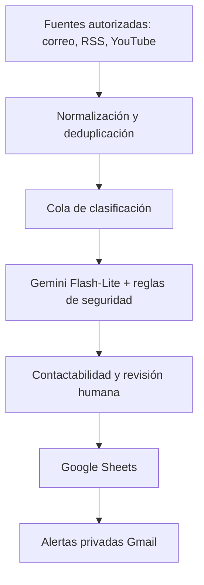

# Student Lead Discovery Agent

**Estado: prototipo en auditoría. Repositorio privado. Código todavía no publicado.**

Sistema de descubrimiento y evaluación de solicitudes públicas de clases particulares, pensado para operar con intervención humana. El diseño utiliza Google Apps Script, Gmail, Google Sheets, conectores autorizados para fuentes públicas y clasificación semántica mediante Gemini Flash-Lite.

> **Sin contacto automático a alumnos:** los rastreadores observan fuentes permitidas y generan alertas privadas; una persona revisa cada oportunidad y decide si corresponde responder.

## Objetivo
Reducir el trabajo manual de encontrar solicitudes explícitas de clases de Matemática, Física, Química y Biología, desde secundaria hasta universidad, sin enviar spam ni recolectar datos innecesarios.

## Arquitectura prevista

## Estado real del desarrollo
- Hay una versión local entregada por Antigravity con 80 pruebas unitarias aprobadas.
- El catálogo de investigación reúne 239 puntos de entrada; **no** equivale a 239 rastreadores activos.
- La integración de Gemini aún necesita corregir su versión del modelo y verificar que sus decisiones afecten al registro de oportunidades.
- Falta integrar y probar en conjunto contactabilidad multired, precios orientativos ARS/USD y perfiles docentes.
- No se ha verificado un despliegue de producción. No hay mensajes automáticos a terceros.

Ver [arquitectura](docs/ARCHITECTURE.md), [estado y pendientes](docs/STATUS.md) y [seguridad](SECURITY.md).

## English summary
Human-in-the-loop tutoring lead discovery and qualification prototype. Designed for authorized public sources, semantic intent classification, persistent deduplication, cost limits, privacy-aware contactability, Google Sheets review, and owner-only Gmail notifications. **Development in progress; not production-ready.**

## Publicación futura
Este repositorio permanecerá privado mientras se revisan código, permisos, credenciales, datos personales y pruebas de extremo a extremo. Las capturas de demostración utilizarán datos sintéticos.
